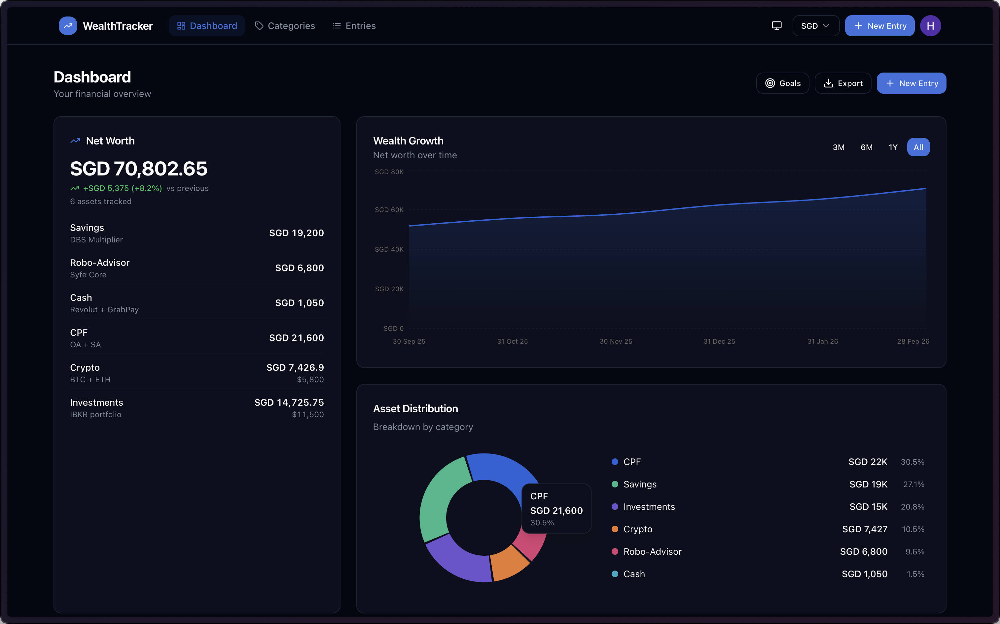

# WealthTracker

A personal net worth tracker with multi-currency support, interactive charts, and bulk asset recording.

**Live:** [wealth.hwendev.com](https://wealth.hwendev.com) | **Status:** [status.hwendev.com](https://status.hwendev.com/status/wealth-tracker)



## Features

- **Multi-currency support** — Track assets in SGD, USD, EUR, and more with live exchange rate conversion
- **Bulk snapshots** — Record all your assets at once with a spreadsheet-style form
- **Interactive charts** — Wealth growth over time (area chart) and asset distribution (donut chart) with time range filters (3M/6M/1Y/All)
- **Category trends** — Per-category sparkline charts showing individual asset growth
- **Goal tracking** — Set net worth targets with deadlines and track progress
- **Milestone celebrations** — Get notified when you hit milestones ($1K, $10K, $100K, etc.)
- **Month-over-month change** — See how your net worth changed since last snapshot
- **CSV import/export** — Bulk import from CSV or export your data for backup
- **Dark mode** — Light, dark, and system theme support
- **Configurable display currency** — Switch your display currency anytime from the header
- **Guided onboarding** — New users get a category selection flow to get started quickly
- **Edit entries** — Update any asset entry directly from the entries view
- **Mobile responsive** — Works on desktop, tablet, and mobile
- **Social auth** — Sign in with email, Google, or GitHub via Clerk

## Tech Stack

| Layer | Technology |
|-------|-----------|
| Framework | React 18 + TypeScript |
| Build | Vite |
| Styling | Tailwind CSS + shadcn/ui |
| Charts | Recharts |
| Auth | Clerk (with JWT integration) |
| Database | Supabase (PostgreSQL) with RLS |
| Exchange Rates | ExchangeRate-API |
| Deployment | Docker (nginx) + Coolify |

## Getting Started

### Prerequisites

- Node.js 18+
- A [Clerk](https://clerk.com) account (for authentication)
- A [Supabase](https://supabase.com) project (for the database)
- An [ExchangeRate-API](https://www.exchangerate-api.com/) key (free tier works)

> For detailed setup instructions (Clerk JWT, Supabase schema, RLS policies, deployment), see **[docs/SETUP.md](docs/SETUP.md)**.

### Quick Start

```bash
# Clone the repo
git clone https://github.com/hwennnn/wealth-tracker.git
cd wealth-tracker

# Install dependencies
npm install

# Copy env file and fill in your keys
cp .env.example .env

# Start dev server
npm run dev
```

### Environment Variables

Create a `.env` file (see `.env.example`):

```env
VITE_CLERK_PUBLISHABLE_KEY=pk_test_xxxxx
VITE_SUPABASE_URL=https://your-project.supabase.co
VITE_SUPABASE_ANON_KEY=your-supabase-anon-key
VITE_EXCHANGE_RATE_API_KEY=your-exchangerate-api-key
```

### Database Schema

Run in **Supabase SQL Editor**:

```sql
CREATE TABLE categories (
  id UUID PRIMARY KEY DEFAULT gen_random_uuid(),
  name TEXT NOT NULL,
  description TEXT DEFAULT '',
  user_id TEXT NOT NULL,
  created_at TIMESTAMPTZ DEFAULT NOW()
);

CREATE TABLE entries (
  id UUID PRIMARY KEY DEFAULT gen_random_uuid(),
  category_id UUID NOT NULL REFERENCES categories(id) ON DELETE CASCADE,
  amount NUMERIC NOT NULL,
  currency TEXT NOT NULL DEFAULT 'SGD',
  date TIMESTAMPTZ NOT NULL,
  notes TEXT DEFAULT '',
  user_id TEXT NOT NULL
);

CREATE INDEX idx_categories_user_id ON categories(user_id);
CREATE INDEX idx_entries_user_id ON entries(user_id);
CREATE INDEX idx_entries_date ON entries(date DESC);
```

### Row Level Security

The app uses Clerk JWTs to authenticate Supabase requests. After setting up the Clerk JWT template (see [docs/SETUP.md](docs/SETUP.md)):

```sql
ALTER TABLE categories ENABLE ROW LEVEL SECURITY;
ALTER TABLE entries ENABLE ROW LEVEL SECURITY;

CREATE POLICY "Users can view own categories" ON categories FOR SELECT USING (auth.jwt() ->> 'sub' = user_id);
CREATE POLICY "Users can insert own categories" ON categories FOR INSERT WITH CHECK (auth.jwt() ->> 'sub' = user_id);
CREATE POLICY "Users can update own categories" ON categories FOR UPDATE USING (auth.jwt() ->> 'sub' = user_id) WITH CHECK (auth.jwt() ->> 'sub' = user_id);
CREATE POLICY "Users can delete own categories" ON categories FOR DELETE USING (auth.jwt() ->> 'sub' = user_id);

CREATE POLICY "Users can view own entries" ON entries FOR SELECT USING (auth.jwt() ->> 'sub' = user_id);
CREATE POLICY "Users can insert own entries" ON entries FOR INSERT WITH CHECK (auth.jwt() ->> 'sub' = user_id);
CREATE POLICY "Users can update own entries" ON entries FOR UPDATE USING (auth.jwt() ->> 'sub' = user_id) WITH CHECK (auth.jwt() ->> 'sub' = user_id);
CREATE POLICY "Users can delete own entries" ON entries FOR DELETE USING (auth.jwt() ->> 'sub' = user_id);
```

### Docker Deployment

```bash
docker build -t wealth-tracker .
docker run -p 80:80 wealth-tracker
```

Pass env vars as build args (Vite embeds them at build time):

```bash
docker build \
  --build-arg VITE_CLERK_PUBLISHABLE_KEY=pk_live_xxx \
  --build-arg VITE_SUPABASE_URL=https://xxx.supabase.co \
  --build-arg VITE_SUPABASE_ANON_KEY=xxx \
  --build-arg VITE_EXCHANGE_RATE_API_KEY=xxx \
  -t wealth-tracker .
```

## Project Structure

```
src/
├── components/
│   ├── ui/              # shadcn/ui primitives
│   ├── BulkEntryForm    # Spreadsheet-style entry form
│   ├── CategoryTrends   # Per-category sparkline charts
│   ├── GoalDialog       # Goal setting modal
│   ├── Layout           # App shell (nav, footer)
│   ├── Onboarding       # New user category setup
│   ├── WealthChart      # Growth + distribution charts
│   └── WealthSummaryCard # Net worth card with MoM change
├── hooks/
│   └── use-theme        # Dark/light/system theme
├── integrations/
│   └── supabase/        # Supabase client (with Clerk JWT auth)
├── lib/
│   ├── auth             # Clerk migration helpers
│   ├── csv              # CSV import/export
│   ├── currency         # Exchange rates + formatting
│   ├── currencyData     # Supported currencies list
│   ├── goals            # Goal & milestone tracking (localStorage)
│   └── types            # TypeScript type definitions
├── pages/
│   ├── Auth             # Sign in/up page (Clerk)
│   ├── Categories       # Category CRUD
│   ├── Dashboard        # Main dashboard
│   ├── Entries          # Entry list + edit + delete
│   ├── NewEntry         # Bulk entry creation
│   ├── Privacy          # Privacy policy
│   └── Terms            # Terms of service
├── App.tsx              # Root component, routing, state
└── main.tsx             # Entry point
```

## License

MIT
